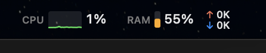
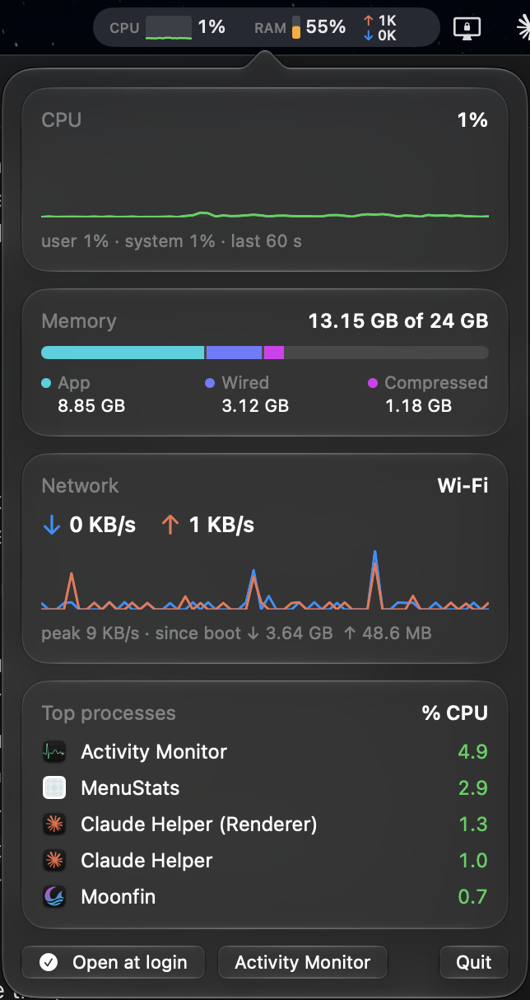

# MenuStats

A small, offline macOS menu bar monitor for CPU, memory and network, with a Liquid Glass detail panel.

<p align="center">
  <br><br>
  
</p>

## Why

I wanted live system stats in my menu bar, and found a popular app for it. Before installing it, I
looked inside: it ships a background helper that runs as root, asks for Location, Bluetooth and
Calendar access, and talks to several web services. That's a lot of trust for a few numbers in a menu bar.

So I built my own. MenuStats only reads counters the kernel already keeps. It makes **no network
connections**, installs **no helpers**, needs **no root** and asks for **no permissions**. All of the
code is in a few small files you can read in one sitting.

## Features

- **Menu bar:** a CPU sparkline, a RAM fill bar and stacked upload/download speeds, colour-coded by load:
  green below 50%, amber from 50% to 80%, red above 80%.
- **Panel (click the menu bar item):** Liquid Glass cards showing:
  - CPU: a 60-second history graph, plus the user/system split
  - Memory: a breakdown of app, wired and compressed memory, the same "Memory Used" figure Activity Monitor shows
  - Network: download and upload graphs, the active interface, the peak speed and totals since boot
  - Top processes: the 5 busiest processes by CPU, with app icons
- **Lightweight:** about 2% CPU and about 80 MB of memory.

## How it works

| Stat | Source |
| --- | --- |
| CPU | `host_statistics(HOST_CPU_LOAD_INFO)`: tick counters, compared between samples |
| Memory | `host_statistics64(HOST_VM_INFO64)`: app (internal minus purgeable) + wired + compressed pages |
| Network | `sysctl(NET_RT_IFLIST2)`: 64-bit byte counters for physical interfaces only, so VPN tunnels aren't counted twice |
| Interface name | SystemConfiguration: the primary IPv4 interface's display name |
| Processes | `proc_listallpids` + `proc_pidinfo(PROC_PIDTASKINFO)`: CPU time per process, compared between samples |

A single `Monitor` samples once a second and keeps 60 seconds of history, so the menu bar and the panel
always agree. The process list is only sampled while the panel is open. The menu bar item is drawn as one
image that adapts to light and dark menu bars. The panel is SwiftUI, using `GlassEffectContainer` and `.glassEffect()`.

| File | Purpose |
| --- | --- |
| [`Sources/Samplers.swift`](Sources/Samplers.swift) | Reads CPU, memory, network and per-process counters |
| [`Sources/Monitor.swift`](Sources/Monitor.swift) | Samples once a second and keeps 60 s of history |
| [`Sources/MenuBarRenderer.swift`](Sources/MenuBarRenderer.swift) | Draws the menu bar image |
| [`Sources/PanelView.swift`](Sources/PanelView.swift) | SwiftUI Liquid Glass panel |
| [`Sources/Format.swift`](Sources/Format.swift) | Number formatting and colours |
| [`Sources/main.swift`](Sources/main.swift) | App entry point, status item and popover |

## Build

Requires macOS 26 or later and the Xcode command line tools (`swiftc`). No Xcode project and no dependencies.

```bash
./build.sh            # builds build/MenuStats.app
./build.sh install    # also copies it to ~/Applications and launches it
```

The app is ad-hoc signed. To start it automatically, turn on **Open at login** in the panel.

## Limitations

- The process list only shows your own processes. Reading system processes (WindowServer, for example)
  needs root, which MenuStats deliberately doesn't have.
- There are no temperature or fan readings, for the same reason.

## License

[MIT](LICENSE)
